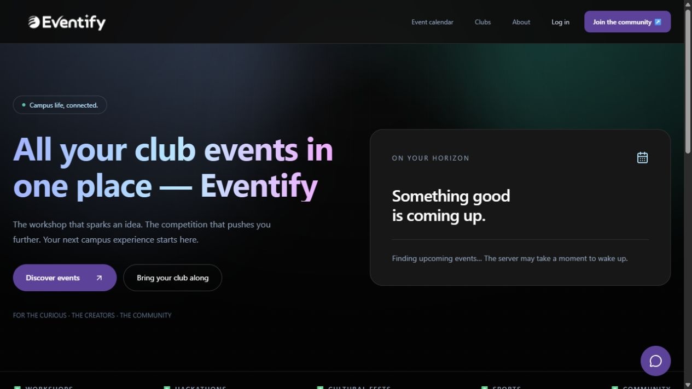

<div align="center">

# Eventify

### Find your people. Make your moment.

A university event platform for discovery, organizer approval, registrations and participation certificates.

[Live demo](https://eventify.tahmidkhan.com.bd) · [Source](https://github.com/tahmidkhanshuvo/Eventify) · [Report a problem](https://github.com/tahmidkhanshuvo/Eventify/issues)

  

</div>



Originally built by **Team If_It_Works_It_Works** for **AUST CSE Carnival 6.0 Hackathon**. The application now uses real account/event data throughout its calendar, dashboards and approved-club directory. An empty calendar means no upcoming events have been published; sample cards are not presented as real events. Free hosting may take a moment to wake after inactivity.

## Explore the application

| Role        | Working flows                                                                                                                                       |
| ----------- | --------------------------------------------------------------------------------------------------------------------------------------------------- |
| Visitor     | Discover upcoming events, search the calendar, explore approved clubs, read event details and built-in help                                         |
| Student     | Register/sign in, enroll or cancel, view personal registrations, update a profile, download certificates after an event ends                        |
| Organizer   | Apply with club details, sign in after approval using the chosen password, create/edit events, set capacity, upload banners/logos, manage attendees |
| Super Admin | Review organizer applications and manage access through the separate administrator portal                                                           |

Capacity is checked in a MongoDB transaction, so two simultaneous registrations cannot take the same final place. Event edits are restricted to their creator or a Super Admin. Only authorized organizers can see attendee details. Certificates use the actual participant and organizing club.

## Run locally

Use **Node.js 22+** and a **MongoDB replica set**. An Atlas free cluster supports the transactions used by registration.

```sh
cd backend
npm ci
cp .env.example .env
# Fill MONGO_URI, JWT_SECRET and the local/public origins.
npm run dev
```

In a second terminal:

```sh
cd frontend
npm ci
cp .env.example .env
npm run dev
```

Open `http://localhost:5173`. The API listens on port 5000. `VITE_API_BASE_URL` is an origin such as `http://localhost:5000`, without `/api`; the client adds API paths. Leave it empty to use Vite's local proxy or a correctly configured same-origin deployment.

### First administrator

Set `SUPER_ADMIN_EMAIL`, a strong `SUPER_ADMIN_PASSWORD` of at least 12 characters, and optionally `SUPER_ADMIN_USERNAME` in the backend environment. Run:

```sh
cd backend
node scripts/create-admin.js
```

The helper creates a new administrator only. It does not delete data, reset passwords, or promote an existing account. No production credentials are documented or seeded automatically.

## Environment

| Backend variable                                                       | Purpose                                                                |
| ---------------------------------------------------------------------- | ---------------------------------------------------------------------- |
| `MONGO_URI`                                                            | MongoDB replica-set connection, including the intended database name   |
| `JWT_SECRET`                                                           | Strong server-only signing secret; required, with no built-in fallback |
| `PORT`, `NODE_ENV`                                                     | Listener and production cookie behavior                                |
| `APP_URL_LOCAL`, `APP_URL`                                             | Allowed frontend origins; comma-separated lists are supported          |
| `IMAGEKIT_PUBLIC_KEY`, `IMAGEKIT_PRIVATE_KEY`, `IMAGEKIT_URL_ENDPOINT` | Durable event banners and club logos                                   |
| `SMTP_HOST`, `SMTP_PORT`, `SMTP_USER`, `SMTP_PASS`, `MAIL_FROM`        | Optional configured mail transport                                     |
| `SUPER_ADMIN_*`                                                        | Explicit administrator setup helper                                    |

Only `VITE_API_BASE_URL` belongs in the frontend. Vite-prefixed values are public. Keep database credentials, JWT secrets and ImageKit private keys in the backend environment. Real `.env` files and dependency folders are ignored by Git. Previously tracked files remain in Git history; rotate any credentials that were historically published.

## Repository guide

| Directory                                     | Responsibility                                             |
| --------------------------------------------- | ---------------------------------------------------------- |
| `backend/controllers`, `routes`, `middleware` | Express API, authorization and upload validation           |
| `backend/models`                              | User, event and registration data                          |
| `backend/services`                            | Image storage helpers                                      |
| `backend/__tests__`, `tests`                  | Workflow/image tests and isolated database lifecycle       |
| `frontend/src/navbar`, `Pages`                | Public pages, event flows, profiles and management screens |
| `frontend/src/dashboard`, `SuperAdmin`        | Role-specific navigation and administrator portal          |
| `frontend/src/hooks`, `api.js`                | Session state and authenticated API requests               |

## API landmarks

| Endpoint                                                           | Purpose                                                      |
| ------------------------------------------------------------------ | ------------------------------------------------------------ |
| `GET /healthz`                                                     | Process/database readiness; returns 503 when disconnected    |
| `GET /api/events`, `GET /api/events/:id`                           | Upcoming calendar and event details/count                    |
| `GET /api/users/clubs`                                             | Approved public club profiles; excludes private account data |
| `GET /api/events/my`                                               | Organizer's own events                                       |
| `POST /api/events/:id/register`, `DELETE /api/events/:id/register` | Enrollment and cancellation                                  |
| `GET /api/registrations/my-events`                                 | Student registration dashboard                               |
| `GET /api/events/:id/attendees`                                    | Authorized attendee list                                     |
| `POST` or `PATCH /api/events/:id/banner`                           | 16:9 banner upload, downscaled to at most 1920×1080          |
| `GET /api/certificates/event/:eventId`                             | Registered student's certificate after the event             |

## Verification

```sh
cd backend
npm test -- --runInBand
cd ../frontend
npm run build
```

The suite covers account approval/sign-in, event creation, student enrollment, certificates, permission failures, competing registrations for the final place, public club privacy, banner uploads and club-logo dimensions. Tests create an isolated in-memory replica set by default; the first run downloads MongoDB binaries. An optional `TEST_MONGO_BASE_URI` creates a fresh uniquely named test database and removes only its own collections afterward. Never point ad-hoc cleanup scripts at a real application database.

## Deployment

Use the existing free Render Node API with root `backend`, build `npm ci`, start `npm start`, and readiness path `/healthz`. Configure Atlas, signing secret, ImageKit and allowed origins in Render. The frontend can use the existing Render static site or Vercel with root `frontend`, build `npm run build`, output `dist`, and the API origin in `VITE_API_BASE_URL`. `frontend/vercel.json` forwards same-origin API requests to the existing Render service and preserves client-side routes on refresh. Leave the frontend API variable empty to use that proxy, or set the direct API origin explicitly.

Verify a public calendar request, sign-in, a registration/cancellation, and an organizer management screen after deployment. Use a disposable event/account for write checks. Keep original application data intact, retain a previous successful deployment for rollback, and review environment settings before changing a domain.

